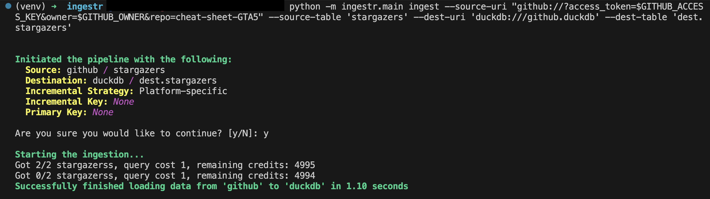

# GitHub

[GitHub](https://github.com/) is a developer platform that allows developers to create, store, manage and share their code.

ingestr supports GitHub as a source.

## URI format

The URI format for GitHub is as follows:

```plaintext
github://?access_token=<access_token>&owner=<owner>&repo=<repo>
```

URI parameters:

- `access_token` (required for `issues`, `pull_requests` and `stargazers`): Access Token used for authentication with the GitHub API
- `owner` (required): Refers to the owner of the repository
- `repo` (required): Refers to the name of the repository


## Setting up a GitHub Integration

To connect to GitHub, you need to create a Personal Access Token (PAT).

### Step 1: Create a Personal Access Token

1. Log in to [GitHub](https://github.com/)
2. Click your profile picture → **Settings**
3. Scroll down and click **Developer settings** in the left sidebar
4. Click **Personal access tokens** → **Tokens (classic)** or **Fine-grained tokens**

### Option A: Classic Token

1. Click **Generate new token** → **Generate new token (classic)**
2. Enter a note (e.g., "Data Integration")
3. Select an expiration period
4. Select scopes:
   - `repo` - Full access to repositories (for private repos)
   - `public_repo` - Access to public repositories only
5. Click **Generate token**
6. Copy the token immediately (starts with `ghp_`)

### Option B: Fine-grained Token (Recommended)

1. Click **Generate new token** → **Generate new token (fine-grained)**
2. Enter a token name and expiration
3. Under **Repository access**, select the repositories you need
4. Under **Permissions**, set:
   - **Issues**: Read-only (for issues table)
   - **Pull requests**: Read-only (for pull_requests table)
   - **Contents**: Read-only (for commits and repo_events)
   - **Pull requests**: Read-only (for commits: landing times of PR merges)
   - **Metadata**: Read-only (required)
5. Click **Generate token**
6. Copy the token (starts with `github_pat_`)

> **Note**: `issues`, `pull_requests` and `stargazers` read GitHub's GraphQL API, which needs an access token. `commits` and `repo_events` can read public repositories without one, but a token is recommended: unauthenticated requests are limited to 60 per hour per IP, authenticated ones to 5,000 per hour.
>
> When GitHub reports that a rate limit is exceeded, ingestr waits for the time GitHub asks for (the `Retry-After` header, or until the limit resets; at least one second and at most one hour) and retries up to 5 times, printing a warning with each wait. For a secondary rate limit without either, it waits one minute and doubles the wait on each retry.

Once you have your access token, let's say your access token is `ghp_test_1234`, the owner is `max`, and the name of the repository is `test_example`. Here is a sample command that will copy the data from GitHub into a DuckDB database:

```sh
ingestr ingest --source-uri 'github://?access_token=ghp_test_1234&owner=max&repo=test_example' --source-table 'issues' --dest-uri duckdb:///github.duckdb --dest-table 'dest.issues'
```

This is a sample command that will copy the data from the GitHub source to DuckDB.



## Tables

GitHub source allows ingesting the following sources into separate tables:
| Table           | PK | Inc Key | Inc Strategy | Details                                                                                                                                        |
| --------------- | ----------- | --------------- | ------------------- | ---------------------------------------------------------------------------------------------------------------------------------------------- |
| `commits`       | `sha` | `landed_at` | merge | Retrieves the commits that landed on (were pushed or merged into) the default branch during `--interval-start`/`--interval-end`, by landing time rather than by the commit's own date. Without an interval, the last 24 hours. See [Commits](#commits). |
| `issues`        | - | –                | replace               | Retrieves GitHub issues along with their comments and reactions. Full reload on each run.                                        |
| `pull_requests` | - | –                | replace               | Retrieves pull requests with comments and reactions. Full reload on each run.                                                    |
| `repo_events`   | `id` | `created_at`     | merge  | Retrieves recent repository events. Appends only new events using `created_at` filter. Only events from the past 30 days allowed. |
| `stargazers`    | - | –                | replace               | Retrieves stargazers. Full reload on each run.                                  |


Use these as `--source-table` parameter in the `ingestr ingest` command.

## Commits

A commit's own date is written by the author's clock and can be days or years older than the moment the commit
reached the default branch (a merged branch keeps its commits' dates, a local merge can be pushed later). The
`commits` table therefore walks the default branch's history and returns every commit whose **landing time**
falls in the interval, with these columns besides the commit's own data:

| Column | Meaning |
|---|---|
| `landed_at` | When the commit reached the default branch. Always set: the exact time, or an estimate inside the window below. |
| `landed_at_min`, `landed_at_max` | The window the landing time is known to be in (`landed_at_min` null = no lower bound). |
| `landed_at_exact` | `true` when the landing time comes from GitHub's server (`landed_at_min` = `landed_at_max`). |
| `landed_at_source` | `pr_merged_at`, `activity_log`, `ci_record`, `github_signed` or `client_date`; `+window` when that source only bounds this commit. |
| `landed_via_sha` | The push head or merge commit that brought the commit onto the branch. |
| `pr_number` | The pull request that merged it, when the landing time comes from a pull request. |
| `removed_from_branch_at` | Set when a force push removed the commit from the branch; filter on `removed_from_branch_at IS NULL` for the current branch. |
| `authored_at`, `committed_at` | The commit's own author and committer dates. |

Landing times come from pull request merges, the repository activity log (pushes since March 2023) and check suites
created by pushes (GitHub keeps check data for at most 400 days). Without access to the activity log or to check
suites (e.g. a fine-grained token cannot read check suites), the run continues with wider windows and logs a warning.
A row is returned when its window overlaps the interval, so a commit with an uncertain landing time can appear in
two neighbouring intervals; the `merge` strategy keeps one row per `sha`.

Older intervals cost more: the history is walked from today's head back to the interval.

Re-ingesting an old interval can lower the precision of some rows (a PR that GitHub later hid, CI records GitHub
deletes after about 400 days, a force-pushed-away commit whose landing is no longer in the activity log); the rows
stay correct, their window gets wider.

> **Upgrading:** earlier versions filtered this table by the committer date and had no landing columns. Run the
> `commits` table once with `--full-refresh` over the period you need, so old rows get the new columns.
 