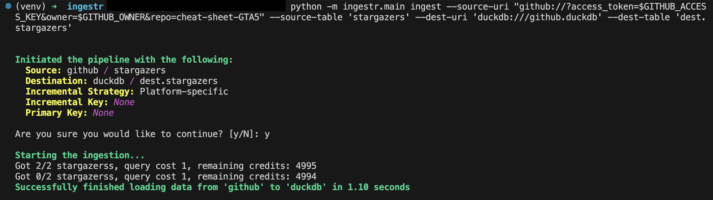

# GitHub

[GitHub](https://github.com/) is a developer platform that allows developers to create, store, manage and share their code.

ingestr supports GitHub as a source.

## URI format

The URI format for GitHub is as follows:

```plaintext
github://?access_token=<access_token>&owner=<owner>&repo=<repo>
```

URI parameters:

- `access_token` (required for `issues`, `pull_requests`, `pull_request_commits` and `stargazers`): Access Token used for authentication with the GitHub API
- `owner` (required for every table except `commits` and `pull_request_commits` with a repository list): Refers to the owner of the repository (a user or an organization)
- `repo` (required for every table except `repositories`, `commits` and `pull_request_commits`): Refers to the name of the repository, without the owner (e.g. `ingestr`, not `bruin-data/ingestr`). `repo` needs `owner`.

Without `owner`, only `commits` and `pull_request_commits` with a repository list can be read, and every entry of the list needs its owner: `commits:<owner>/<repo>` or `commits:<owner>/*` (see [Reading commits from several repositories](#reading-commits-from-several-repositories)). `repositories` needs `owner`; `issues`, `pull_requests`, `stargazers` and `repo_events` need both `owner` and `repo`.

To ingest the repositories of a user or organization, leave out `repo` and use the `repositories` table (`repo` is ignored for this table):

```sh
ingestr ingest --source-uri 'github://?access_token=ghp_test_1234&owner=max' --source-table 'repositories' --dest-uri duckdb:///github.duckdb --dest-table 'dest.repositories'
```

## Setting up a GitHub Integration

To connect to GitHub, you need to create a Personal Access Token (PAT).

### Step 1: Create a Personal Access Token

1. Log in to [GitHub](https://github.com/)
2. Click your profile picture → **Settings**
3. Scroll down and click **Developer settings** in the left sidebar
4. Click **Personal access tokens** → **Tokens (classic)** or **Fine-grained tokens**

### Option A: Classic Token

1. Click **Generate new token** → **Generate new token (classic)**
2. Enter a note (e.g., "Data Integration")
3. Select an expiration period
4. Select scopes:
   - `repo` - Full access to repositories (for private repos)
   - `public_repo` - Access to public repositories only
5. Click **Generate token**
6. Copy the token immediately (starts with `ghp_`)

### Option B: Fine-grained Token (Recommended)

1. Click **Generate new token** → **Generate new token (fine-grained)**
2. Enter a token name and expiration
3. Under **Repository access**, select the repositories you need
4. Under **Permissions**, set:
   - **Issues**: Read-only (for issues table)
   - **Pull requests**: Read-only (for pull_requests and pull_request_commits tables)
   - **Contents**: Read-only (for commits and repo_events)
   - **Metadata**: Read-only (required)
5. Click **Generate token**
6. Copy the token (starts with `github_pat_`)

> **Note**: `issues`, `pull_requests`, `pull_request_commits` and `stargazers` read GitHub's GraphQL API, which needs an access token. `commits`, `repo_events` and `repositories` can read public data without one, but a token is recommended: unauthenticated requests are limited to 60 per hour per IP, authenticated ones to 5,000 per hour.
>
> When GitHub reports that a rate limit is exceeded, ingestr waits for the time GitHub asks for (the `Retry-After` header, or until the limit resets; at least one second and at most one hour) and retries up to 5 times, printing a warning with each wait. For a secondary rate limit without either, it waits one minute and doubles the wait on each retry.

Once you have your access token, let's say your access token is `ghp_test_1234`, the owner is `max`, and the name of the repository is `test_example`. Here is a sample command that will copy the data from GitHub into a DuckDB database:

```sh
ingestr ingest --source-uri 'github://?access_token=ghp_test_1234&owner=max&repo=test_example' --source-table 'issues' --dest-uri duckdb:///github.duckdb --dest-table 'dest.issues'
```

This is a sample command that will copy the data from the GitHub source to DuckDB.



## Tables

GitHub source allows ingesting the following sources into separate tables:
| Table           | PK | Inc Key | Inc Strategy | Details                                                                                                                                        |
| --------------- | ----------- | --------------- | ------------------- | ---------------------------------------------------------------------------------------------------------------------------------------------- |
| `commits`       | `sha` (single repository) or `repo`, `sha` (list and all modes) | `committed_at` | merge | Retrieves commits on the default branch of one, several or all repositories of `owner` (see [Reading commits from several repositories](#reading-commits-from-several-repositories)), with the repository in `repo`, including signature verification (`commit.verification`). `--interval-start`/`--interval-end` filter on the committer date, which `committed_at` mirrors. Commits pushed after their interval has already run are not picked up; use a lookback window. |
| `issues`        | - | –                | replace               | Retrieves GitHub issues along with their comments and reactions. Full reload on each run.                                        |
| `pull_requests` | - | –                | replace               | Retrieves pull requests with comments and reactions. Full reload on each run.                                                    |
| `pull_request_commits` | `repo`, `pr_number`, `sha` | `pr_updated_at` | merge | Retrieves every commit of every pull request (open, closed and merged) of one, several or all repositories of `owner`, with signature verification. See [Pull request commits](#pull-request-commits). |
| `repo_events`   | `id` | `created_at`     | merge  | Retrieves recent repository events. Appends only new events using `created_at` filter. Only events from the past 30 days allowed. |
| `repositories`  | `id` | –                | replace               | Retrieves the repositories owned by `owner`, including forks and archived repositories. Private repositories are included when the token can see them: the organization's repositories the token has access to, a user's own repositories when `owner` is the token's user, or the repositories a GitHub App installation token was granted. Otherwise only public repositories are returned. `id`, `node_id`, `name`, `full_name`, `owner`, `private`, `fork`, `html_url` and `description` are always present; other fields GitHub returns are added when at least one repository has a value for them. Full reload on each run. |
| `stargazers`    | - | –                | replace               | Retrieves stargazers. Full reload on each run.                                  |


Use these as `--source-table` parameter in the `ingestr ingest` command.

## Reading commits from several repositories

`pull_request_commits` takes the same repository list and modes as `commits` (write `pull_request_commits:<repo>,<owner>/<repo>,<owner>/*`); its primary key is `repo`, `pr_number`, `sha` in every mode. A repository found through `<owner>/*` or all mode that GitHub's GraphQL API can't find is skipped with a warning; any other GraphQL error, such as a token without access to pull requests, fails the run.

The `commits` table can read many repositories, of one or several owners, into one table. Which repositories it reads depends on the URI's `repo` and on an optional comma-separated list appended to the table name:

| Mode | Source table | Repositories read | PK |
| ---- | ------------ | ----------------- | -- |
| single | `commits`, URI has `repo` | the URI repository | `sha` |
| list | `commits:<repo>,<owner>/<repo>,<owner>/*,...` | the listed repositories, and every repository of each `<owner>/*` except forks; the list overrides a `repo` in the URI | `repo`, `sha` |
| all | `commits`, URI has `owner` and no `repo` (or an empty `repo=`) | every repository the token can list for `owner` (see `repositories`), except forks; archived repositories are included | `repo`, `sha` |

Every row has a `repo` column with the repository's `owner/name` as GitHub spells it, whatever the casing in the URI or the list. List and all modes use `repo` and `sha` as the primary key, since a commit can appear in more than one repository (e.g. a fork).

In list mode, an entry is one of:

- `<repo>`: a repository of the URI `owner`. Without `owner` in the URI, the run fails before reading anything.
- `<owner>/<repo>`: a repository of any owner.
- `<owner>/*`: every repository of `<owner>` the token can list (as for the `repositories` table), except forks.

Any other form, such as `<owner>/`, `*` or `<owner>/bruin-*`, fails the run before reading anything. Spaces, empty entries and repeated entries are ignored, and names are case-insensitive. Each repository named with `<repo>` or `<owner>/<repo>` is looked up directly, so any repository the token can read works, including a private repository it collaborates on and a renamed repository under its old name. A named fork is read. If a named repository is not found or the token cannot read it, the run fails before any commit is read, naming every such repository. The named repositories are read first, in the order written, then the repositories of each `<owner>/*`, in the order written. A repository that is both named and matched by `<owner>/*` is read once, as a named repository.

For all mode and each `<owner>/*`, ingestr prints how many repositories it reads and how many forks it skips. A repository found this way that GitHub refuses to serve (not found, blocked, or forbidden for a reason other than a rate limit) is skipped with a warning; a named repository or the single-mode repository fails the run instead.

Examples:

Fetch the commits of three repositories, two of them from the URI owner:

```sh
ingestr ingest \
  --source-uri 'github://?access_token=ghp_test_1234&owner=bruin-data' \
  --source-table 'commits:bruin, ingestr, other-org/tool' \
  --dest-uri duckdb:///github.duckdb \
  --dest-table 'dest.commits'
```

Fetch the commits of every repository of `bruin-data` except forks, plus one repository of another owner, with a URI without `owner`:

```sh
ingestr ingest \
  --source-uri 'github://?access_token=ghp_test_1234' \
  --source-table 'commits:bruin-data/*, other-org/tool' \
  --dest-uri duckdb:///github.duckdb \
  --dest-table 'dest.commits'
```

Fetch the commits of every repository of `bruin-data` except forks:

```sh
ingestr ingest \
  --source-uri 'github://?access_token=ghp_test_1234&owner=bruin-data' \
  --source-table 'commits' \
  --dest-uri duckdb:///github.duckdb \
  --dest-table 'dest.commits'
```

> [!NOTE]
> Set `--dest-table` when the source table lists repositories; otherwise the destination table is named after the whole `commits:...` value.

> [!WARNING]
> Single mode keeps `sha` as the primary key, so existing single-repository tables keep working and get `repo` filled in on their next run. To switch an existing single-repository table to list or all mode, run it once with `--full-refresh`: rows written before the `repo` column existed have no `repo` and would otherwise not match.

## Pull request commits

`pull_request_commits` has one row per commit of each pull request: `repo`, `pr_number` and `sha`. A commit that is part of several pull requests gets a row in each.

Which pull requests are read: those last updated at or after `--interval-start` and, when `--interval-end` is set, before it, so `pr_updated_at` always falls inside the interval. Pull requests are listed from the most recently updated: those updated at or after `--interval-end` are skipped (the run whose interval holds their last update reads them), and the listing stops at the first one updated before `--interval-start`. Without an interval, every pull request of the repository is read. Commits are not filtered by their own dates. Any change to a pull request (a push, a comment, a label, a merge) updates it, so a lookback window such as `--interval-start` 30 days ago picks up every pull request that changed in that window.

The commits of a pull request are the ones it lists, as GitHub shows them on its Commits tab. GitHub lists at most 250 commits of a pull request; for a larger pull request only the newest 250 are read, with a warning naming it. If the pull request changes while its commits are read (for example a push between two pages), they are read again from the start, with a warning, up to 3 times; if they still don't match, the run fails.

Columns:

| Column | Description |
| ------ | ----------- |
| `repo`, `pr_number`, `sha` | Repository (`owner/name` as GitHub spells it), pull request number and commit SHA |
| `pr_state` | `open`, `closed` (closed without merge) or `merged` |
| `pr_url`, `pr_title`, `pr_author` | Pull request link, title and author login |
| `pr_created_at`, `pr_updated_at`, `pr_closed_at`, `pr_merged_at` | Pull request timestamps |
| `base_ref`, `head_ref` | Branch the pull request targets, branch it comes from |
| `head_repo` | Repository the head branch lives in (a fork for fork pull requests); empty when the fork was deleted |
| `merge_commit_sha` | The commit GitHub records for the merge: the merge or squash commit, the last rebased commit, or the head commit of a fast-forward merge |
| `commit_url` | Commit page on GitHub, which shows the Verified badge |
| `message` | Commit message |
| `author_name`, `author_email`, `author_login`, `authored_at` | Commit author and the account GitHub links to it |
| `committer_name`, `committer_email`, `committer_login`, `committed_at` | Committer; commits GitHub itself made (merges or edits in the web UI) have `committer_login = web-flow` |
| `parent_count` | Number of parents (2 or more for merge commits) |
| `verified`, `verification_reason` | Signature verification as in the REST API (`valid`, `unsigned`, `unknown_key`, ...) |
| `signed_by_github` | The commit was signed by GitHub's own key (made through the web UI or the API) |

Example: read the pull request commits of every repository of `bruin-data` updated in the last 30 days:

```sh
ingestr ingest \
  --source-uri 'github://?access_token=ghp_test_1234' \
  --source-table 'pull_request_commits:bruin-data/*' \
  --interval-start "$(date -u -v-30d +%Y-%m-%dT%H:%M:%SZ)" \
  --interval-end "$(date -u +%Y-%m-%dT%H:%M:%SZ)" \
  --dest-uri duckdb:///github.duckdb \
  --dest-table 'dest.pull_request_commits'
```

Limits:

- A pull request with more than 250 commits: only its newest 250 commits are read.
- Commits a force push removed from a pull request are not read; only the commits the pull request lists now.
- A rebase merge creates new commits on the base branch; they are not pull request commits, so they don't appear in this table.
- Branches that never had a pull request are not read.
- `author_login` and `committer_login` can be empty for some commits although the REST API links the same email to an account.
